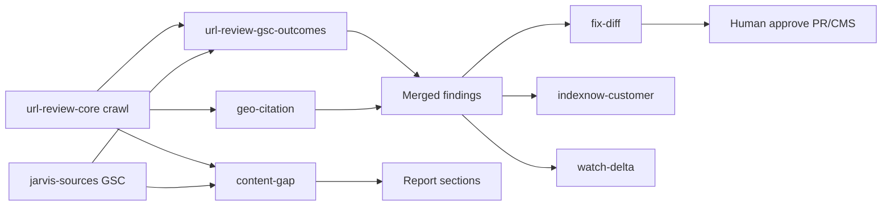

# #4360 — Audit→outcomes loop (implementation spec)

**Branch:** `docs/4360-outcomes-spec`  
**Worktree:** `.worktrees/docs-4360-outcomes-spec`  
**Epic:** [#4360](https://github.com/kaanmuar/kaanmuar.github.io/issues/4360)  
**Session B:** Implement child tickets in order below; one PR per child when possible.

---

## Goal

Close the loop from **URL Review audit** → **measurable search/AI outcomes** → **human-approved remediation**, without becoming a content mill or autoblogger.

The product stays **auditor + remediator**: surface decay, cannibalization, gaps, and citation visibility; ship **surgical fix packs** as reviewable Git PRs or CMS drafts; optionally **ping IndexNow** for customer sites; run **white-label watch** reports with deltas.

**Existing surface (do not conflate):** `functions/url-review-outcomes.js` (#4296) maps findings to commerce/marketing/engagement/security **CTA packs** for outreach. The #4360 modules add **GSC/AI/crawl operational findings** and **delivery/watch** layers on top of `url-review-core` findings.

---

## Child tickets

| Ticket | Title | Planned module(s) |
|--------|--------|-------------------|
| [#4361](https://github.com/kaanmuar/kaanmuar.github.io/issues/4361) | Customer Search Console decay findings in URL Review | `url-review-gsc-outcomes` (decay) |
| [#4362](https://github.com/kaanmuar/kaanmuar.github.io/issues/4362) | Query cannibalization / ownership map | `url-review-gsc-outcomes` (cannibalization) |
| [#4363](https://github.com/kaanmuar/kaanmuar.github.io/issues/4363) | Audit-only content gap matrix | `content-gap` |
| [#4364](https://github.com/kaanmuar/kaanmuar.github.io/issues/4364) | Surgical fix packs as Git PR or CMS draft | `fix-diff` |
| [#4365](https://github.com/kaanmuar/kaanmuar.github.io/issues/4365) | Customer IndexNow + crawl-health dispatcher | `indexnow-customer` |
| [#4366](https://github.com/kaanmuar/kaanmuar.github.io/issues/4366) | White-label continuous watch (GSC + AI citation deltas) | `watch-delta` |
| [#3553](https://github.com/kaanmuar/kaanmuar.github.io/issues/3553) | Vertex-grounded AI citation check in GEO | `geo-citation` |

**Parent linkage:** GitHub allows one parent per issue. #3553 remains under [#3475](https://github.com/kaanmuar/kaanmuar.github.io/issues/3475); track it in this epic checklist only (see #4360 comment).

**Suggested implementation order:** #3553 + #4361 → #4362 → #4363 → #4364 → #4365 → #4366 (watch consumes all upstream outputs).

---

## Non-goals

- **No Soro / autoblogger:** no daily auto-publish, brand-voice article mills, or unattended CMS go-live.
- No backlink exchanges, Reddit/Quora spam agents, or “write for me” long-form generation in #4363 (briefs/table only).
- No auto-merge of fix PRs (#4364): human approval required.
- Do not repurpose Jarvis **origin** IndexNow (`functions/jarvis-index.js`, site key at repo root) for arbitrary customer domains without per-site keys (#4365).
- Do not replace existing static llms.txt GEO checks; **augment** with citation grounding (#3553).

---

## Module map

### `url-review-gsc-outcomes` — #4361, #4362

**New file:** `functions/url-review-gsc-outcomes.js`  
**Tests:** `tests/unit/url-review-gsc-outcomes.test.js`

| Export (MVP) | Input | Output |
|--------------|-------|--------|
| `gscDecayFindings(pages, gscRows)` | Reviewed page list + GSC `page`/`date` rows | `findings[]` (area SEO, keys e.g. `gsc-decay-*`) |
| `cannibalizationFindings(gscRows)` | GSC `query`×`page` rows | `findings[]` (keep/merge/redirect hints) |

**Reuse:**

- GSC HTTP/query patterns: `functions/jarvis-sources.js` (`searchConsole`, dimensions, row limits).
- Finding shape / attach: same conventions as `url-review-core` + `url-review-findings-en.js` (register keys + copy).
- Optional client GSC: extend customer/agency credential path used by URL Review (do not require GSC for core audit).

**Wire-in:** Call after crawl findings merge when `ctx.gsc` present; severity tip/low for decay unless thresholds crossed (align #4361 body).

---

### `geo-citation` — #3553

**New file:** `functions/geo-citation.js`  
**Tests:** `tests/unit/geo-citation.test.js`

One **Search-grounded** Gemini/Vertex check: whether the reviewed **domain** is cited for its core topic (alongside existing `geo-llms` static checks).

**Reuse:**

- `groundedCall` / `vertexDiagnose` patterns: `functions/url-review-rescue.js`.
- GEO area, tip/low severity per #3553.

**Wire-in:** GEO pass in `url-review-core` or deep review path when money/MCP slices allow; gate on API quota like other Vertex calls.

---

### `content-gap` — #4363

**New file:** `functions/content-gap.js`  
**Tests:** `tests/unit/content-gap.test.js`

**Export (MVP):** `contentGapMatrix({ crawlPages, gscRows?, intents? })` → prioritized table: `keep | merge | redirect | write-manually` with **brief stubs only** (no draft bodies).

**Reuse:** Crawl inventory from review; optional GSC top queries from `jarvis-sources` shape; duplicate-title / near-duplicate signals already in SEO findings.

**Wire-in:** Report section + JSON on review payload; desk/UI read-only table (`url-review-desk.js` or insights strip).

---

### `fix-diff` — #4364

**New file:** `functions/fix-diff.js`  
**Tests:** `tests/unit/fix-diff.test.js`

Package selected findings into **reviewable artifacts**:

- GitHub PR payload (branch, files, schema/header diffs) — pattern from fix kits / PageSpeed routine PRs (`functions/index.js` ~#1978).
- CMS draft stub (metadata only, no publish).

**Reuse:** `url-review-outcomes` `primaryCta.actionType: 'fix_package'` + existing fix-package HTTP in `scripts/url-review-server.js`.

**Wire-in:** Explicit user/agency action; never cron-auto-live.

---

### `indexnow-customer` — #4365

**New file:** `functions/indexnow-customer.js`  
**Tests:** `tests/unit/indexnow-customer.test.js`

For **reviewed customer sites** (opt-in):

1. Verify IndexNow key at `{origin}/{key}.txt`
2. Skip `noindex` / 4xx URLs
3. POST changed URLs to `api.indexnow.org`
4. Log HTTP status per URL (Firestore or review log)

**Reuse:** Request shape from `functions/jarvis-index.js` `indexNow()` — **per-customer key**, not `INDEXNOW_KEY` constant.

**Wire-in:** Agency/customer setting flag; dispatcher callable from watch or manual “push crawl updates”.

---

### `watch-delta` — #4366 (FE-heavy)

**New files:**

- `functions/watch-delta.js` — compare prior vs current review + GSC snapshot + `geo-citation` result
- Front-end surfaces in admin/agency white-label (exact paths TBD in #4366)

**Export (MVP):** `buildWatchReport({ prior, current, gscDelta?, citationDelta? })` → branded markdown/PDF sections.

**Reuse:** Scheduled re-audit hooks (`url-review-batch`, agency mail); insights from `url-review-insights.js`.

---

## Integration sketch



**`functions/index.js`:** require new modules alongside existing `url-review-*` requires (~2550+); add routes only where child tickets specify.

**Failures registry:** add `FIXES` rows in `functions/url-review-failures.js` when a slice fixes a recurring URL-review failure mode.

---

## Verification commands

Run from worktree root (quiet, targeted):

```bash
# Decay + cannibalization unit tests (after #4361/#4362)
node --test tests/unit/url-review-gsc-outcomes.test.js

# AI citation (#3553)
node --test tests/unit/geo-citation.test.js

# Content gap matrix (#4363)
node --test tests/unit/content-gap.test.js

# Fix pack builder (#4364)
node --test tests/unit/fix-diff.test.js

# Customer IndexNow (#4365)
node --test tests/unit/indexnow-customer.test.js

# Watch deltas (#4366)
node --test tests/unit/watch-delta.test.js

# Regression: existing outcomes CTA packs (#4296)
node --test tests/unit/url-review-outcomes.test.js

# Full review unit gate (CI parity, slower)
npm run test:review
```

**Manual smoke (when wired):**

- Local review server: `node scripts/url-review-server.js` — run one URL with mock GSC fixture.
- Jarvis GSC path: exercise `jarvis-sources` `searchConsole` against a test property (credentials required).

---

## Session B checklist

1. Confirm worktree: `scripts/ticket-worktree.sh docs/4360-outcomes-spec`
2. Implement one child ticket; register finding keys + EN copy before UI.
3. Add unit test file from table above; run targeted `node --test` only.
4. `scripts/ticket.sh move <n> QA` when ready; PR body cites #4360 and child issue.
5. Do not expand scope into autoblogging or unmanaged publish.

---

## References

- Epic body: #4360
- GSC queries: `functions/jarvis-sources.js`
- IndexNow (origin site): `functions/jarvis-index.js`, `tests/unit/jarvis-index.test.js`
- Outreach outcome packs: `functions/url-review-outcomes.js`, `tests/unit/url-review-outcomes.test.js`
- capo.js fix-diff inspiration (head ordering): `.cursor/rules/tool-arsenal.mdc` (#3830) — unrelated to #4364 module name but useful for HTML fix diffs