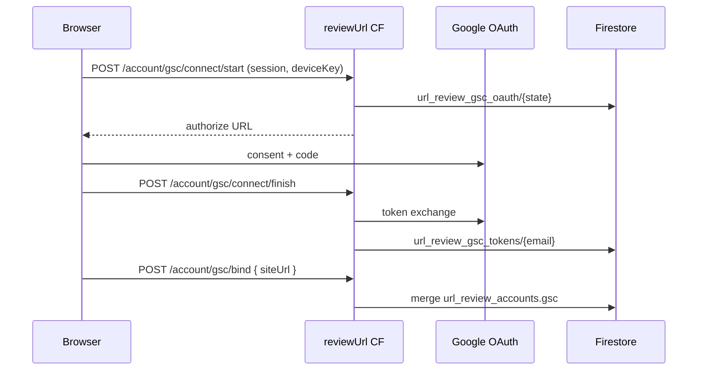

# #4377 / #4388 — Customer GSC OAuth property bind (design)

**Design ticket:** [#4388](https://github.com/kaanmuar/kaanmuar.github.io/issues/4388) (parent design for [#4389](https://github.com/kaanmuar/kaanmuar.github.io/issues/4389) / PR [#4393](https://github.com/kaanmuar/kaanmuar.github.io/pull/4393))  
**Original:** [#4377](https://github.com/kaanmuar/kaanmuar.github.io/issues/4377) — handoff PR [#4387](https://github.com/kaanmuar/kaanmuar.github.io/pull/4387)  
**Epic:** [#4360](https://github.com/kaanmuar/kaanmuar.github.io/issues/4360) — audit→outcomes loop  
**Feeds:** `url-review-gsc-outcomes` (#4361/#4362, #4375 wire-in) with real customer GSC rows instead of agency-only SA.

---

## Problem

Jarvis and URL Review today read **our** Search Console via the Cloud Functions **service account** (`jarvis-sources.searchConsole` → metadata `googleToken` + `sc-domain:carlosandmunoz.com`). Customer reviews need **the signed-in visitor’s** GSC property with **read-only** scope, bound to the hostname under review, without exposing refresh tokens to the browser.

`functions/url-review-gsc-outcomes.js` is intentionally **pure** (rows in, findings out). OAuth and token refresh belong in a separate module and routes.

---

## Existing patterns to reuse

| Area | Location | Reuse |
|------|-----------|--------|
| Review sign-in providers | `REVIEW_SIGN_IN_PROVIDERS`, `functions/url-review-auth.js` | Session + `deviceHash`; account row `url_review_accounts/{email}` |
| Firebase Google sign-in | `POST …/auth/provider` + `googleAccessToken` | Identity only; **not** sufficient for GSC — separate incremental OAuth |
| Server-side OAuth (PKCE) | `functions/url-review-oauth.js`, `COL = url_review_oauth` | State TTL, device binding, `finishOAuth`, env `REVIEW_OAUTH_{PROVIDER}_ID/_SECRET` |
| Auth route shape | `functions/index.js` `reviewSignIn`, `scripts/url-review-server.js` | `POST /auth/oauth/{id}/start`, `POST /auth/oauth/finish` |
| GSC HTTP | `functions/jarvis-sources.js` `searchConsole`, `webmasters/v3/sites/.../searchAnalytics/query` | Same API with **user** bearer from stored token |
| Property URL formats | Jarvis uses `sc-domain:{DOMAIN}`; API also uses URL-prefix `https://host/path/` | Normalization: `functions/url-review-gsc-property.js` (#4377 stub) |
| Path keys for row merge | `url-review-gsc-outcomes.pageKey` | Page paths after property bind |

**Do not** reuse review sign-in OAuth clients for GSC (different scopes, consent screen, redirect). **Do not** send GSC refresh tokens to the client or store them in `localStorage`.

---

## OAuth

### Scopes

| Scope | Purpose |
|-------|---------|
| `https://www.googleapis.com/auth/webmasters.readonly` | `sites.list`, `searchAnalytics/query` |
| (optional) `openid email` | Tie connection to same Google account when not already Firebase `google.com` |

No `webmasters` (write). No Analytics, Ads, or Drive.

### Client / secrets

New env (Secret Manager in prod), parallel to `REVIEW_OAUTH_*`:

```bash
REVIEW_GSC_OAUTH_CLIENT_ID=
REVIEW_GSC_OAUTH_CLIENT_SECRET=
# Comma hosts allowed for redirect_uri (prod + local review server)
REVIEW_GSC_OAUTH_REDIRECT_ORIGINS=https://carlosandmunoz.com,http://127.0.0.1:8765
```

### Google Cloud OAuth client + consent screen

Use a **dedicated** OAuth web client (not `REVIEW_OAUTH_*` sign-in clients). Same Firebase/GCP project as `reviewUrl`.

| Console step | Value |
|--------------|--------|
| APIs | Enable **Google Search Console API** (`webmasters.googleapis.com`) |
| Consent screen type | External (production) or Internal (staff-only QA until verified) |
| App name / support email | QA Lab URL Review / agency contact |
| Authorized domains | `carlosandmunoz.com` |
| Scopes (sensitive) | `…/auth/webmasters.readonly` only (+ `openid`, `email` via OAuth library) |
| Test users | All QA testers while app status is **Testing**; publish only after Google sensitive-scope verification |
| Credentials → OAuth client | **Web application** |
| Authorized JavaScript origins | `https://carlosandmunoz.com`, `http://127.0.0.1:8765` |
| Authorized redirect URIs | `https://carlosandmunoz.com/qa-review.html`, `http://127.0.0.1:8765/qa-review.html` |

Consent UX copy should name **read-only Search Console** access for the signed-in review account; link to the public privacy policy. Google’s sensitive-scope review is required before non–test-user production traffic.

Store `REVIEW_GSC_OAUTH_CLIENT_ID` in env; **`REVIEW_GSC_OAUTH_CLIENT_SECRET` in Secret Manager only** (never Hosting, never client).

### Flow (incremental auth)

1. Visitor has valid `url_review_sessions` (email sign-in or Firebase provider).
2. `POST /account/gsc/connect/start` → state row + authorize URL (`access_type=offline`, `prompt=consent` on first connect).
3. Browser returns to review/account page with `code` + `state` (same pattern as `url-review-oauth` finish on page).
4. `POST /account/gsc/connect/finish` → exchange code **server-side**, persist **refresh_token** + `googleSub`, list `sites.list`.
5. `POST /account/gsc/bind` → user picks `siteUrl` from list (must `propertyCoversSite` for default review host).
6. Review run loads tokens by **account email**, queries GSC for **bound property**, passes rows into `url-review-gsc-outcomes.findings`.

Mermaid:



---

## Token storage sketch

### Primary: Firestore (match review auth)

| Collection | Doc id | Fields (MVP) |
|------------|--------|----------------|
| `url_review_gsc_oauth` | `state` (48 hex) | `email`, `deviceHash`, `verifier?`, `redirectUri`, `expiresAt`, `used` |
| `url_review_gsc_tokens` | `email` | `refreshToken` (encrypted), `accessToken`, `accessExpiresAt`, `googleSub`, `scopes`, `connectedAt`, `revokedAt?` |
| `url_review_accounts` | `email` | `gsc: { siteUrl, kind, host, boundAt, verified }` |

**Encryption at rest (hard gate — [#4395](https://github.com/kaanmuar/kaanmuar.github.io/issues/4395)):** `refreshToken` must be **encrypted before Firestore write** (Cloud KMS or envelope key in Secret Manager) and decrypted only inside server code paths that call Google. PR [#4393](https://github.com/kaanmuar/kaanmuar.github.io/pull/4393) stores plaintext `refresh_token` until #4395 lands — **do not set production secrets or invite customers until encryption ships.** Never log tokens or ciphertext.

### Feature flag (runtime)

Routes and UI stay **closed** unless **both** `REVIEW_GSC_OAUTH_CLIENT_ID` and `REVIEW_GSC_OAUTH_CLIENT_SECRET` are set (`url-review-gsc-oauth.ready()` → 503 “not open yet”; `connectStatus.open === false`). Empty env is the default in all deployed environments.

| Signal | Meaning for UI |
|--------|----------------|
| `open: false` | Hide Search Console connect affordances (no dead buttons) |
| `open: true`, `connected: false` | Show “Connect Search Console” |
| `connected: true`, `bound: null` | Show property picker (`GET /account/gsc/sites` → `POST /account/gsc/bind`) |
| `bound` set, `coversReviewHost: false` | Warn: bound property does not cover URL under review; outcomes slice skipped |
| `code: reconnect` | Prompt reconnect after `invalid_grant` |

Do **not** add a separate public feature flag env; missing credentials **is** the flag until ops deliberately enables the slice.

Refresh: before GSC calls, if `accessExpiresAt` < now + 60s, `POST https://oauth2.googleapis.com/token` with `refresh_token`. On `invalid_grant`, clear row and surface “Reconnect Search Console”.

TTL: optional Firestore TTL on `url_review_gsc_oauth` states (10 min, same as sign-in OAuth).

### Optional edge cache (Workers KV / D1 sketch)

For high-volume re-queries without hitting Firestore each time:

| Store | Key | Value | TTL |
|-------|-----|-------|-----|
| **KV** | `gsc:atk:{emailHash}` | short-lived access token + expiry ISO | match Google `expires_in` |
| **D1** `gsc_tokens` | `email` PK | `refresh_ciphertext`, `updated_at`, `site_url` | — |

Worker **only** refreshes access tokens; refresh ciphertext stays in D1/Firestore. Callable from a future `workers/review-gsc` route — **not required for MVP** (Cloud Functions only).

---

## Property ↔ review bind

1. From review target URL, `gscPropertyCandidates(url)` proposes `sc-domain:apex`, `https://{host}/`, etc. (`url-review-gsc-property.js`).
2. After OAuth, `GET /account/gsc/sites` returns filtered `sites.list` entries user can verify.
3. Bind stores `siteUrl` on account; per-run override optional on agency desk later.
4. At review time: `propertyCoversSite(bound, targetUrl)` — if false, skip GSC slice (audit still runs).
5. Pass `encodeURIComponent(siteUrl)` into GSC API paths (same as Jarvis).

Downstream: #4375 / #4361 wire passes `ctx.gsc` into `url-review-gsc-outcomes.findings`.

### Account / review UX (#4389 follow-up — not in PR #4393)

Surface on **`qa-review-account.html`** (signed-in account) with status mirrored on **`qa-review.html`** when a URL is loaded:

1. **Disconnected** — secondary button “Connect Google Search Console”; helper text: read-only, server-stored, disconnect anytime.
2. **Connect** — `POST /account/gsc/connect/start` with `redirectUri` = current page origin + `/qa-review.html` (or account page if finish handler lives there). Full redirect to Google; on return, page reads `code` + `state` from query and calls `POST /account/gsc/connect/finish` with `deviceKey` (same as sign-in OAuth finish).
3. **Connected, unbound** — list from `GET /account/gsc/sites`; radio/select per `siteUrl`. Pre-select entries where `propertyCoversSite(siteUrl, reviewUrl)` if review URL present. Primary “Use this property”.
4. **Bound** — show `bound.siteUrl`, `coversReviewHost` badge, “Change property”, “Disconnect” (`POST /account/gsc/disconnect`).
5. **Errors** — map `code`: `other-device`, `expired`, `reconnect`, `cancelled` to plain copy; never show tokens.

MVP: one bound property per `url_review_accounts` email. No GSC UI on anonymous review runs.

---

## Route names (Workers / `reviewUrl` / local server)

Implement on **`reviewUrl`** (`functions/index.js` → `reviewAccount` or new `reviewGsc`) and mirror in `scripts/url-review-server.js`:

| Method | Path | Auth | Purpose |
|--------|------|------|---------|
| `POST` | `/account/gsc/connect/start` | session + device | Return Google authorize URL |
| `POST` | `/account/gsc/connect/finish` | session + device | Exchange code, store tokens |
| `GET` | `/account/gsc/status` | session | `{ connected, siteUrl, coversReviewHost? }` |
| `GET` | `/account/gsc/sites` | session | List verified properties (readonly) |
| `POST` | `/account/gsc/bind` | session | `{ siteUrl }` → account.gsc |
| `POST` | `/account/gsc/disconnect` | session | Revoke + delete token row |

**Workers (future):** if GSC fetch moves to edge, name handlers `gscConnectStart`, `gscConnectFinish`, `gscBind` on the same path prefix behind Hosting rewrite — keep path parity with CF.

OAuth **redirect URI** (register in Google console; **decision for #4389**):

- **`https://carlosandmunoz.com/qa-review.html`** and **`http://127.0.0.1:8765/qa-review.html`** — same query-param finish pattern as `url-review-oauth` (#4393 default `redirectUri`).
- Origins allowed by server: `REVIEW_GSC_OAUTH_REDIRECT_ORIGINS=https://carlosandmunoz.com,http://127.0.0.1:8765` (full `redirect_uri` must be under those origins).

---

## Production enablement — do **not** yet

Keep **all** of the following off in production until the row is checked:

| Gate | Ticket / note |
|------|----------------|
| Secret Manager `REVIEW_GSC_OAUTH_CLIENT_SECRET` + non-empty `REVIEW_GSC_OAUTH_CLIENT_ID` | Ops |
| Refresh token **encryption at rest** | [#4395](https://github.com/kaanmuar/kaanmuar.github.io/issues/4395) |
| Google sensitive-scope verification (or Internal-only client) | Console |
| Account UI + finish handler on review/account pages | #4389 (not in #4393) |
| Review path fetch: customer GSC rows → `extras.gsc` / outcomes | #4375 wire-in |
| Firestore rules: deny client read/write on `url_review_gsc_tokens` | Security review with #4395 |

Safe to merge **#4393** (routes + unit tests): feature stays 503 until env is set. **Unsafe:** setting secrets in prod before #4395 and UI.

---

## Security notes

- **No refresh tokens in the client** — only opaque session + short-lived access never returned to browser for GSC.
- **Device binding** on OAuth state (same as `url-review-oauth`) — finish on wrong device → 403.
- **Session required** for all `/account/gsc/*`; no anonymous GSC connect.
- **Scope minimization** — `webmasters.readonly` only; deny if token missing scope.
- **CSRF** — state nonce; POST finish with session cookie/body session id.
- **Revocation** — disconnect calls Google revoke endpoint best-effort, then delete Firestore token doc.
- **Agency** — later: separate bind per client profile; MVP = one property per account email.
- **Logging** — log connect/disconnect events without tokens (email hash ok).

---

## Implementation status

| Slice | Status |
|-------|--------|
| `functions/url-review-gsc-property.js` + tests | Shipped ([#4387](https://github.com/kaanmuar/kaanmuar.github.io/pull/4387)) |
| `functions/url-review-gsc-oauth.js` + routes + tests | PR [#4393](https://github.com/kaanmuar/kaanmuar.github.io/pull/4393) ([#4389](https://github.com/kaanmuar/kaanmuar.github.io/issues/4389)) |
| Token encryption | [#4395](https://github.com/kaanmuar/kaanmuar.github.io/issues/4395) — blocks prod secrets |
| Account UI + OAuth finish on page | #4389 — **not in #4393** |
| Review run GSC fetch when bound | #4375 — **not in #4393** |

### Gap vs PR #4393 (expected)

- **Aligned:** scopes, `prompt=consent` + `access_type=offline`, device-bound state, redirect origin allowlist, env-gated `ready()`, collections `url_review_gsc_oauth` / `url_review_gsc_tokens`, bind validates `sites.list`, disconnect revokes.
- **Gap (follow tickets):** plaintext `refreshToken` in Firestore (#4395); no HTML/JS for connect/bind; no `qa-review.html` GSC callback handler; no Firestore rules update documented; review path still agency SA only.

---

## Verification

```bash
node --test tests/unit/url-review-gsc-property.test.js
node --test tests/unit/url-review-gsc-oauth.test.js      # after #4393
node --test tests/unit/url-review-gsc-outcomes.test.js   # unchanged
# Integration (manual): local server + test OAuth client + GSC test property — only after #4395 in non-prod or encrypted store
```

---

## References

- Epic spec: `.cursor/handoffs/4360-outcomes-spec.md`
- GSC queries (agency): `functions/jarvis-sources.js`
- Outcomes (customer rows): `functions/url-review-gsc-outcomes.js` (feat-4361 / #4375)
- Sign-in OAuth: `functions/url-review-oauth.js`, `functions/.env.example`